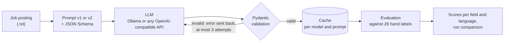

# Job Posting Extractor

[](https://github.com/Rafet01/job-posting-extractor/actions/workflows/tests.yml)

Turns free-text job ads in English, German and French into structured, validated data with a local LLM, and measures how often it gets each field right.

## In 30 seconds

- **What:** a Python pipeline that reads a job posting and extracts twelve fields (company, title, locations, workload, duration, start date, language requirements, degree level, internship or not, required skills). Every answer is checked against a schema and retried if it is invalid.
- **Why:** I was applying for internships in Switzerland and kept reading the same ads for the same facts: *Do I need German? Can bachelor students apply? Which tools are required?* I built this to automate that part of my own search, and to learn how to measure whether an LLM is actually right.
- **How quality was measured:** I hand-labelled 26 real postings using written annotation guidelines. Four setups (two local models × two prompts) were scored field by field against those labels, with a significance test for the differences.
- **Main result:** the best setup, Llama 3.1 8B with the simple prompt, got **254 of 312 values right (mean field score 0.81)**. It is near-perfect on company, locations and workload, but weak on required skills (0.48) and degree level (0.40). A longer prompt built from my annotation guidelines did **not** beat it: the small models copied example values from the prompt into their answers.
- **Skills shown:** LLM structured output, prompt design, Pydantic validation, evaluation design (annotation guidelines, field-specific metrics, macro F1, sign tests), error analysis, Python and pandas, testing with mocks, GitHub Actions CI.

## Contents

[How it works](#how-it-works) · [Run it yourself](#run-it-yourself) · [The data and labels](#the-data-and-labels) · [How quality is measured](#how-quality-is-measured) · [Results](#results) · [What went wrong and why](#what-went-wrong-and-why) · [Limitations and next steps](#limitations-and-next-steps) · [Tests and CI](#tests-and-ci) · [Repository layout](#repository-layout) · [About this project](#about-this-project)

## How it works



1. **Prompt** ([prompts.py](src/extractor/prompts.py)). The system prompt contains the JSON Schema generated from the Pydantic model, and the posting is the user message. Two versions exist. **v1** is short and relies on the field descriptions in the schema. **v2** restates the annotation guidelines as explicit rules per field.
2. **LLM call** ([llm.py](src/extractor/llm.py)). It uses the OpenAI Python client in JSON mode with temperature 0, so the same code talks to a local Ollama server or to a paid API.
3. **Validation and retries** ([schema.py](src/extractor/schema.py)). The answer must parse into a `JobPosting`: categories are fixed (`german_level` ∈ none/plus/required), percentages lie between 10 and 100, the minimum workload can't exceed the maximum, unknown fields are rejected and skills are cleaned. If validation fails, the error message is sent back to the model so it can correct itself.
4. **Cache** ([run.py](src/extractor/run.py)). Each valid result is stored as JSON per model and prompt version, so a run can be interrupted and resumed, and evaluation never needs the LLM. Failed postings are not cached and are retried on the next run.
5. **Evaluation** ([evaluate.py](src/extractor/evaluate.py), [metrics.py](src/extractor/metrics.py), [compare.py](src/extractor/compare.py)). Predictions are compared with the labels using a metric chosen per field. Results are written as CSVs, and runs are compared posting by posting.

**Extracted fields**

| Field | Type | Example |
|---|---|---|
| company, role_title | text | `Deloitte`, `AI & Analytics Consulting Manager` |
| locations | list | `["Basel", "Zurich", "Geneva"]` |
| workload_min, workload_max | percent | `80`, `100` |
| duration_months | number | `6` |
| start | text | `February 2027`, `asap` |
| german_level | none / plus / required | `plus` |
| english_required | true / false | `true` |
| degree_level | bachelor_ok / master_only / graduate_only / unknown | `bachelor_ok` |
| is_internship | true / false | `true` |
| required_skills | list | `["python", "sql"]` |

## Run it yourself

Requirements: Python 3.11 or newer, and [Ollama](https://ollama.com) for free local models. The commands below are for **PowerShell on Windows**, which is what I use. The shell differences are listed after them.

```powershell
git clone https://github.com/Rafet01/job-posting-extractor.git
cd job-posting-extractor
python -m venv .venv
.\.venv\Scripts\Activate.ps1
pip install -r requirements.txt -e .
Copy-Item .env.example .env        # default settings point at a local Ollama server

ollama pull llama3.1
ollama pull qwen2.5:7b
python scripts/check_llm.py        # should answer "pong"
```

Extract, evaluate and compare:

```powershell
python -m extractor.extract_one data/postings/001.txt              # one posting, printed as JSON
python -m extractor.run --model llama3.1 --prompt v1               # all postings, cached in outputs/cache
python -m extractor.evaluate --model llama3.1 --prompt v1          # writes outputs/summary_* and details_*
python -m extractor.compare                                        # writes outputs/comparison.md
python -m pytest                                                   # the test suite, no LLM needed
```

| | PowerShell (Windows) | bash / zsh (macOS, Linux) |
|---|---|---|
| Activate the virtual environment | `.\.venv\Scripts\Activate.ps1` | `source .venv/bin/activate` |
| Copy the settings file | `Copy-Item .env.example .env` | `cp .env.example .env` |
| Set a variable for one session | `$env:LLM_MODEL = "qwen2.5:7b"` | `export LLM_MODEL=qwen2.5:7b` |

If PowerShell refuses to run `Activate.ps1`, allow local scripts once with `Set-ExecutionPolicy -Scope CurrentUser RemoteSigned`.

**Using a paid API instead.** Any OpenAI-compatible endpoint works. Edit `.env` (it is in `.gitignore` and never committed):

```
LLM_BASE_URL=https://api.openai.com/v1
LLM_API_KEY=sk-...
LLM_MODEL=gpt-4o-mini
```

The results below come from local models only. No paid model was evaluated.

**Note on `outputs/`.** The summary, detail and comparison files in `outputs/` are the published results. The raw cache is not committed. On a fresh clone, run the extraction before `extractor.evaluate`. Otherwise every posting is scored as missing and the committed CSVs are overwritten (`git restore outputs/` brings them back). `extractor.compare` works straight away, because it only reads the committed CSVs.

## The data and labels

- **26 real job postings**: 15 English, 8 German and 3 French, mostly Swiss internships and junior data or AI roles, copied from public job listings during my own search. See [data/README.md](data/README.md) for where they come from and how they may be used.
- **One hand label per posting** in [data/labels.csv](data/labels.csv), written according to [docs/annotation_guidelines.md](docs/annotation_guidelines.md).

**Why written guidelines?** Without them, "the right answer" changes from posting to posting. Is "Python, R preferred" a requirement for R? Is a German ad evidence that German is required? The guidelines fix these decisions once, with examples, so the labels are consistent and the model can be held to the same rules. Some of the key decisions:

- **Requirement, task or preference.** Only what the candidate must already bring counts. "You will build Power BI dashboards" is a task. "Power BI is a plus" is a preference. Neither makes Power BI a required skill.
- **Locations are sets.** Every place where the job can be based is recorded, and the comparison ignores order and spelling (`Zürich` = `Zurich` = `Zuerich`, `Genève` = `Geneva`).
- **Skill groups with alternatives.** "Python and one of AWS, Azure or GCP" is labelled `python;aws|azure|gcp`: two requirements, the second satisfied by any one of three tools. Tools named only as examples ("a BI tool such as Power BI") are not requirements.
- **Degree level describes who may apply.** `bachelor_ok` means current bachelor students can apply, and `graduate_only` means a finished degree is required.
- **Defined normalisations.** Gender markers such as `(m/w/d)` are removed from titles, and "ab sofort" / "as soon as possible" become `asap`.

## How quality is measured

Each field gets a metric that fits its type. The scoring rules were fixed before the prompt comparison, and all four runs are scored with the same version ([docs/experiments.md](docs/experiments.md) explains the choices):

| Field | Metric | Why |
|---|---|---|
| company | exact match after normalisation | Legal suffixes such as AG or GmbH don't matter. |
| role_title | character similarity ≥ 0.85 | Tolerates small wording differences. The threshold sits in a natural gap in the observed similarities. |
| locations | F1 per posting, averaged | It's a set: partial credit for finding some of the places. |
| required_skills | F1 per posting, averaged, with alternative groups | Any one alternative satisfies a requirement. Extra skills cost precision. |
| workload, duration | exact match | Numbers with a defined convention, such as the lower bound of a range. |
| start | normalised exact match | A textual proxy: equivalent dates in different formats count as different. |
| class fields | macro F1 over classes | Always guessing the most common class scores high on accuracy but low on macro F1. |

Every posting stays in every denominator. A failed extraction scores zero, it doesn't disappear. Scores are also reported per language. To tell real differences from noise, runs are compared **posting by posting** with an exact sign test, because with 26 postings a difference of one or two postings means nothing.

## Results

Two local models through Ollama: **Llama 3.1 8B** and **Qwen 2.5 7B**, each with **prompt v1** (short) and **v2** (guideline rules), on all **26 postings** (n = 26 for every cell). No extraction failed in any of the four runs. Best score per field in bold.

| Field | Metric | Llama 3.1 v1 | Llama 3.1 v2 | Qwen 2.5 v1 | Qwen 2.5 v2 |
|---|---|---|---|---|---|
| company | normalized exact | **1.00** | 0.96 | 0.88 | 0.92 |
| role_title | title ≥ 0.85 | 0.77 | **0.88** | 0.62 | 0.81 |
| locations | mean posting F1 | **0.99** | 0.72 | 0.87 | 0.64 |
| workload_min | exact | **1.00** | 0.65 | 0.96 | 0.96 |
| workload_max | exact | 0.92 | 0.69 | 0.92 | **0.96** |
| duration_months | exact | **0.81** | 0.58 | 0.54 | 0.62 |
| start | normalized exact (proxy) | 0.81 | 0.65 | 0.58 | **0.85** |
| german_level | macro F1 | 0.80 | 0.77 | **0.87** | 0.67 |
| english_required | macro F1 | **0.85** | 0.81 | 0.69 | 0.73 |
| degree_level | macro F1 | 0.40 | 0.30 | 0.47 | **0.56** |
| is_internship | macro F1 | **0.95** | **0.95** | **0.95** | **0.95** |
| required_skills | mean posting F1 | **0.48** | 0.43 | 0.43 | 0.36 |
| *mean of fields* | | **0.81** | 0.70 | 0.73 | 0.75 |
| *values correct (of 312)* | | **254** | 209 | 226 | 231 |

The per-language tables (English n = 15, German n = 8, French n = 3) and all paired tests are in [outputs/comparison.md](outputs/comparison.md).

**What the paired tests say:**

- **v2 did not improve the fields it targeted.** For skills, degree level and duration, postings moved in both directions. Qwen's degree macro F1 rose from 0.47 to 0.56, but that is 3 postings better and 5 worse, so not an improvement.
- **Where v2 helped:** titles improved for both models (+3/−0 and +5/−0 postings), not significant on their own but in the same direction. Qwen's start date improved significantly (+7/−0, p = 0.02).
- **Where v2 hurt:** Llama's locations (+0/−15) and minimum workload (+0/−9) got significantly worse (p < 0.01), and so did Qwen's locations (+1/−8, p = 0.04).

## What went wrong and why

The full analysis, with real examples per category, is in [docs/error_analysis.md](docs/error_analysis.md). The main findings for the best run (Llama 3.1, v1):

- **"Skill" means something different to the model.** It lists preferred tools, tools from task descriptions and general fields (machine learning, AI) as required skills. This is the main reason required_skills scores only 0.48.
- **Degree labels read as degree levels.** The model gets the degree level wrong for 12 of 26 postings, and 9 of those wrong answers are `bachelor_ok`. "A Bachelor's or Master's degree is required" sounds like *bachelor ok* but means *a finished degree is required*. That is a schema design problem: one label mixes the level and whether the degree must be finished.
- **Other dates taken as the start.** 4 of the 5 start errors (postings 008, 020, 022, 024) are the publication date at the top of the ad.
- **Ranges become missing values.** All 5 missed durations are stated as a range or period, such as "3–6 months", "6 à 12 mois" or "février à juillet". It looked like a French problem, but the French postings simply state ranges.
- **Some labels are debatable.** For a few postings I would defend the label less firmly than the model's answer, for example a "Bachelor's or Master's degree" requirement in an ad whose salary line addresses current students. These cases are listed in [docs/experiments.md](docs/experiments.md#labels-i-think-are-debatable-or-wrong-not-changed). The labels were not changed after the fact.

**The main lesson: example values in a prompt leak into a small model's output.** Prompt v2 used short illustrative examples. The 7–8B models copied them as answers whenever a posting gave nothing for that field:

- Llama wrote the literal string `"[]"` as a location in 9 postings (the prompt said "use [] for fully remote work").
- Llama set a workload of 60% in 5 postings that state no percentage (the prompt's example was "60-80%").
- Llama wrote `asap` in 8 postings that give no start date.
- Qwen listed the prompt's table of canonical skill spellings (`aws, azure, git, react, …`) as required skills for postings 008, 017 and 023.

A rule written more precisely helped less than avoiding copyable values would have.

## Limitations and next steps

**Limitations**

- **26 postings, one annotator.** Only large differences are detectable. Inter-annotator agreement is unknown, so part of the remaining error is label noise.
- **No development set.** v2 was written from the guidelines, but I chose which rules to stress after seeing v1 errors on the same 26 postings. Any gain would have been optimistic. I wrote v2 once and did not tune it on the results.
- **Small local models.** Llama 3.1 8B and Qwen 2.5 7B only, with Ollama's default **4096-token context window**. The longest posting plus prompt v2 fits, but leaves little room for retries.
- **Start is a textual proxy**, and the title threshold is a heuristic.

**With more time I would:**

1. Write a prompt v3 without copyable example values, and test it on new postings.
2. Label 20–30 more postings as a development set, and keep these 26 as a held-out test set.
3. Split `degree_level` into "required level" and "degree must be finished", and store duration ranges as two numbers.
4. Use constrained decoding (Ollama's JSON-schema output) instead of relying on retries.
5. Have a second person label a subset, to measure agreement.
6. Add a paid model as a reference, to separate prompt problems from model-size problems.

## Tests and CI

```powershell
python -m pytest
```

95 tests run in about 4 seconds, **without Ollama, without a `.env` file and without the cache**. The test files read as a specification: each test name states one behaviour.

- **Schema:** invalid categories, out-of-range numbers, min > max, extra fields and an empty company or title are rejected, and skills are cleaned.
- **LLM call:** the OpenAI client is replaced by a `unittest.mock.MagicMock`. The tests check the exact request, that an invalid answer is retried with the validation error, that the call gives up with a clear error after the last attempt, and that connection errors are not swallowed.
- **Batch run** (in temporary folders): cached postings are skipped, failures are reported and not cached, empty postings are never sent, and outdated cache files are re-extracted.
- **Labels:** a malformed `labels.csv` fails with the line, ID and field.
- **Scoring, comparison and prompts:** metrics on hand-calculated examples, the sign test, frozen prompt hashes (so cached results always match their prompt), and a leakage check that v2 shares no five-word sequence with a test posting.

A fixture in [tests/conftest.py](tests/conftest.py) blocks all network connections, so a forgotten real LLM call fails the test instead of reaching a server. [GitHub Actions](.github/workflows/tests.yml) installs the project and runs the suite on every push and pull request.

## Repository layout

```
src/extractor/        the pipeline
  schema.py           Pydantic model of the extracted fields
  prompts.py          prompt versions v1 and v2
  llm.py              LLM call with validation and retries
  run.py              batch extraction with cache
  extract_one.py      extract a single posting
  labels.py           read and validate the hand labels
  normalize.py        canonical spellings used in scoring
  metrics.py          field metrics (exact, similarity, set F1, macro F1)
  evaluate.py         score one run and write summary/details CSVs
  compare.py          compare runs with paired sign tests
data/                 26 postings and labels.csv (see data/README.md)
docs/                 annotation guidelines, experiments, error analysis
outputs/              published scores per run and comparison.md
scripts/              check the LLM connection and validate the labels
tests/                95 tests, no network
```

## About this project

This is a **learning project**, built while preparing internship applications for roles in LLM-based information extraction, data engineering and AI. It is not production software. The goal was to go beyond "the LLM returns JSON" and find out how good the answers actually are, and why.

AI coding assistants helped with parts of the implementation. I designed the labels, the annotation guidelines and the evaluation decisions: which metric fits which field, what counts as a fair comparison, and how to read the results.
